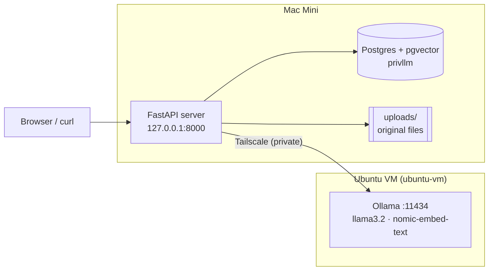

# priv-llm

A private, self-hosted RAG (retrieval-augmented generation) app. Upload your documents, then ask questions and get answers from a local LLM, grounded in your own files and cited back to the source chunks. Nothing leaves your own machines: the model runs on a home server, and everything is reachable only over a private Tailscale network.

> Status: early development. Text (`.txt`) upload, chunking, embedding, and question answering work end to end. PDF, audio, auth, and the web UI are next.

## Design



**Components**

| Part | What it does |
| --- | --- |
| FastAPI (`server/app`) | HTTP API for uploads, document listing, chat, and health checks |
| Postgres + pgvector | Stores documents, text chunks, and 768-dim embeddings with an HNSW cosine index |
| `uploads/` | The original uploaded files, named by SHA-256 hash (gitignored) |
| Ollama on the VM | `nomic-embed-text` for embeddings, `llama3.2` for answers |
| Tailscale | Private network between the Mac and the VM, so Ollama is never exposed to the internet |

**Ingest flow (upload)**

1. Validate the file and hash its contents (SHA-256). Reject duplicates with `409`.
2. Insert a row into `documents`.
3. Split the text into overlapping chunks (`services/chunker.py`).
4. Embed all chunks in one Ollama call (`clients/ai.py`).
5. Insert the chunks and vectors into `chunks`, then mark the document `ready`.

**Query flow (chat)**

1. Embed the question with `nomic-embed-text`.
2. Find the top-k closest chunks with pgvector cosine distance (`<=>`).
3. Build a prompt that tells the model to answer only from those chunks and cite them as `[1]`, `[2]`, …
4. Return the answer plus the source chunks and their distances.

**Security model**

- The API binds to `127.0.0.1` only.
- Ollama listens on the VM, but `ufw` allows port 11434 only on the `tailscale0` interface.
- All SQL uses parameterized queries (`%s`), never string formatting.
- Secrets live in `.env` (gitignored). `.env.example` holds placeholders only.
- Planned: `tailscale serve` for private access from other devices (never `funnel`).

## Project layout

```
server/
├── app/
│   ├── main.py            # FastAPI app, lifespan opens the DB pool
│   ├── config.py          # Settings loaded from .env (pydantic-settings)
│   ├── db.py              # psycopg3 connection pool with pgvector registered
│   ├── clients/ai.py      # Ollama client: chat() and embed()
│   ├── router/
│   │   ├── documents.py   # upload + list documents
│   │   ├── chat.py        # ask a question
│   │   └── health.py      # Postgres + Ollama status
│   ├── schemas/chat.py    # Pydantic request/response models
│   └── services/
│       ├── chunker.py     # text → overlapping chunks
│       ├── retrieval.py   # vector search
│       └── prompts.py     # RAG prompt template
├── db/
│   ├── migrations/        # dbmate migrations
│   └── schema.sql         # dbmate schema dump
├── requirements.txt
└── .env.example
```

## Running it locally

### Prerequisites

- Python 3.12
- Postgres with the `pgvector` extension (Homebrew: `brew install postgresql@17 pgvector`)
- [dbmate](https://github.com/amacneil/dbmate) for migrations (`brew install dbmate`)
- An Ollama server with both models pulled:
  ```bash
  ollama pull llama3.2
  ollama pull nomic-embed-text
  ```
- If Ollama runs on another machine, both machines on the same Tailscale network

### 1. Configure

```bash
cd server
cp .env.example .env
```

Fill in `.env`:

| Variable | Example |
| --- | --- |
| `DATABASE_URL` | `postgres://<user>@localhost:5432/privllm?sslmode=disable` |
| `TEST_DATABASE_URL` | `postgres://<user>@localhost:5432/privllm_test?sslmode=disable` |
| `OLLAMA_URL` | `http://ubuntu-vm:11434` |
| `CHAT_MODEL` | `llama3.2` |
| `EMBED_MODEL` | `nomic-embed-text` |
| `UPLOAD_DIR` | `uploads` (optional) |

### 2. Database

```bash
createdb privllm
createdb privllm_test
dbmate up
```

### 3. Python environment

```bash
python3.12 -m venv .venv
source .venv/bin/activate
pip install -r requirements.txt
```

### 4. Start the server

Run this from `server/`:

```bash
uvicorn app.main:app --reload --host 127.0.0.1 --port 8000
```

Interactive API docs: http://127.0.0.1:8000/docs

## API (so far)

| Method | Path | Description |
| --- | --- | --- |
| `GET` | `/health` | Postgres status and the models available on Ollama |
| `POST` | `/docs` | Upload a `.txt` file (multipart field `file`) |
| `GET` | `/docs` | List uploaded documents |
| `POST` | `/chat/query` | Ask a question: `{"query": "...", "k": 3}` |

> Note: the documents routes will move from `/docs` to `/documents`, since `/docs` is also FastAPI's Swagger UI.

**Examples**

```bash
curl http://127.0.0.1:8000/health

curl -F "file=@sample.txt" http://127.0.0.1:8000/docs

curl -X POST http://127.0.0.1:8000/chat/query \
  -H "Content-Type: application/json" \
  -d '{"query": "What port does Ollama listen on by default?"}'
```

Example response:

```json
{
  "answer": "Ollama listens on port 11434 by default. [1]",
  "sources": [
    {"n": 1, "filename": "sample.txt", "snippet": "Ollama runs large language models locally...", "distance": 0.34}
  ]
}
```

## Roadmap

- [x] Ollama on a private VM over Tailscale
- [x] Postgres + pgvector schema and migrations
- [x] `.txt` upload, chunking, and embeddings
- [x] Retrieval + cited answers
- [ ] Move the duplicate check into the database (unique `sha256` column)
- [ ] Rename the documents routes to `/documents`, plus download and delete
- [ ] PDF support (`pypdf`, with page numbers in citations)
- [ ] Audio support (`faster-whisper`, with timestamps in citations)
- [ ] Background ingestion with a `processing` → `ready` status
- [ ] Streaming answers
- [ ] React + Vite + Tailwind web UI
- [ ] User accounts and per-user documents
- [ ] Private access from other devices via `tailscale serve`
